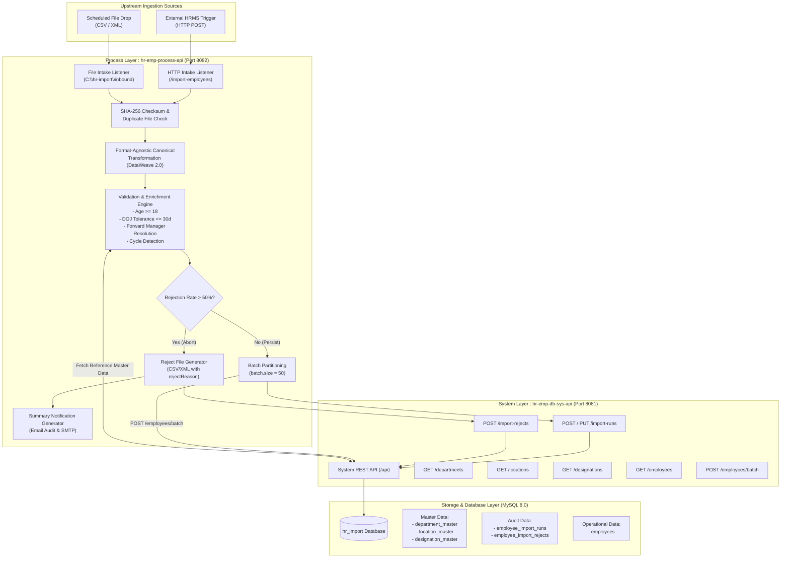
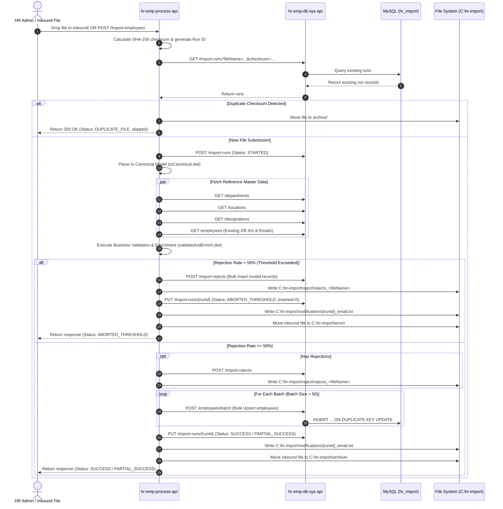

# High-Level Design (HLD)
## HR Bulk Employee Import Integration Solution
**Cognizant – 2027 Nurture Partner Network (NPN) MuleSoft Hackathon Challenge**

---

## 1. Executive Summary & Objectives

The **HR Bulk Employee Import** solution is an enterprise-grade, API-led integration designed on **MuleSoft 4** and **MySQL 8.0**. It automates the intake, parsing, validation, reference enrichment, transactional persistence, error reporting, and stakeholder notification for bulk employee onboarding files supplied in heterogeneous formats (**CSV** and **XML**).

### Core Business Objectives
- **Multi-Format Ingestion**: Ingest CSV and XML employee import files via automated directory polling (`C:\hr-import\inbound`) and RESTful HTTP invocation (`POST /import-employees`).
- **Format-Agnostic Canonical Model**: Normalize diverse payload structures into a unified canonical JSON schema using DataWeave 2.0.
- **Reference Data Enrichment**: Dynamically resolve human-readable department codes, location codes, and designation titles to relational database keys and corporate grades.
- **Forward Reference & Cycle Detection**: Resolve manager-subordinate relationships even when the manager appears later in the same file; detect and reject self-reporting and circular reporting loops.
- **Resilience & Threshold Abort**: Calculate file-level rejection percentages in real-time. If the rejection rate exceeds a configurable threshold (default `50%`), immediately abort database persistence, preserve audit records, generate a reject file in the source format, archive the file to `error/`, and notify HR administrators.
- **Sensitive Data Protection**: Adhere strictly to PII/data privacy mandates by ensuring Date of Birth (DOB), mobile numbers, and personal compensation data are never emitted to logs or notification email bodies.

---

## 2. API-Led Connectivity Architecture

The solution implements MuleSoft's recommended **API-Led Connectivity** methodology, decoupling underlying database operations (System Layer) from business orchestration and intake logic (Process Layer).



---

## 3. End-to-End Orchestration Sequence



---

## 4. Canonical Data Model

Both CSV and XML files are transformed into an identical canonical JSON record array before validation.

### Canonical Schema Representation
```json
{
  "sourceSystem": "HRMS-XML",
  "declaredCount": 5,
  "generatedAt": "2026-09-11T09:00:00Z",
  "recordCount": 5,
  "records": [
    {
      "recordIndex": 1,
      "employeeId": "EMP10041",
      "firstName": "Aditi",
      "lastName": "Sharma",
      "dateOfBirth": "1992-05-14",
      "dateOfJoining": "2026-09-15",
      "officialEmail": "aditi.s@company.com",
      "mobile": "+91-9884022201",
      "departmentCode": "DEPT-ENG",
      "designation": "Senior Engineer",
      "locationCode": "LOC-CHN-01",
      "employmentType": "PERMANENT",
      "managerId": "EMP10002"
    }
  ]
}
```

---

## 5. Business Validation & Reference Enrichment Rules

| # | Validation / Enrichment Rule | Rule Logic | Error Code | Rejection Reason |
|---|-----------------------------|------------|------------|------------------|
| 1 | **Mandatory Fields** | `employeeId`, `firstName`, `lastName`, `dateOfBirth`, `dateOfJoining`, `officialEmail`, `departmentCode`, `locationCode`, `employmentType` must be non-empty | `ERR_REQ_MANDATORY_FIELD_MISSING` | Missing mandatory field: `<fieldName>` |
| 2 | **Email Format** | Must conform to standard email regex: `^[A-Za-z0-9._%+-]+@[A-Za-z0-9.-]+\.[A-Za-z]{2,}$` | `ERR_FMT_INVALID_EMAIL` | Invalid email format: `<email>` |
| 3 | **Duplicate Email** | Unique within input file and globally unique across existing employees in `employees` | `ERR_DUP_OFFICIAL_EMAIL` | Official email '`<email>`' is already assigned to another employee |
| 4 | **Mobile Number Format** | Optional, but if present must match regex: `^\+?[0-9\s\-()]{7,20}$` | `ERR_FMT_INVALID_MOBILE` | Invalid mobile number format: `<mobile>` |
| 5 | **Date of Birth** | Valid ISO date format `YYYY-MM-DD` | `ERR_FMT_INVALID_DOB` | Unparseable date of birth: `<dob>` |
| 6 | **Minimum Age** | Age calculated from DOB to current date must be $\ge 18$ years | `ERR_VAL_UNDERAGE` | Employee age (`<age>`) is below minimum required age of 18 |
| 7 | **Date of Joining** | Valid ISO date format `YYYY-MM-DD` | `ERR_FMT_INVALID_DOJ` | Unparseable date of joining: `<doj>` |
| 8 | **Future DOJ Tolerance** | Date of joining must not exceed 30 days in the future | `ERR_VAL_FUTURE_JOINING_DATE` | Joining date '`<doj>`' exceeds allowed future tolerance of 30 days |
| 9 | **Employment Type** | Must be one of `PERMANENT`, `CONTRACT`, `FULL-TIME`, `PART-TIME`, `INTERN` | `ERR_VAL_INVALID_EMPLOYMENT_TYPE` | Unsupported employment type: `<employmentType>` |
| 10 | **Department Enrichment** | `departmentCode` must match an active record in `department_master`; enriches `department_key` | `ERR_REF_DEPARTMENT_NOT_FOUND` | Department '`<deptCode>`' does not exist in the department master |
| 11 | **Location Enrichment** | `locationCode` must match an active record in `location_master`; enriches `location_key` | `ERR_REF_LOCATION_NOT_FOUND` | Location '`<locCode>`' does not exist in the location master |
| 12 | **Designation Enrichment** | `designation` (case-insensitive) matches `designation_master`; enriches `grade` | `ERR_REF_DESIGNATION_NOT_FOUND` | Designation '`<designation>`' does not exist in the designation master |
| 13 | **Duplicate Employee ID** | `employeeId` must not appear multiple times in the same import file | `ERR_DUP_EMPLOYEE_ID_FILE` | Duplicate employee identifier within file: `<empId>` |
| 14 | **Self-Reporting** | Subordinate `employeeId` equals `managerId` | `ERR_REL_SELF_REPORTING` | Employee cannot be their own manager: `<empId>` |
| 15 | **Circular Reporting** | Mutual reporting detected within file ($A \rightarrow B$ and $B \rightarrow A$) | `ERR_REL_CIRCULAR_REPORTING` | Circular reporting relationship detected between `<empA>` and `<empB>` |
| 16 | **Forward Manager Resolution** | `managerId` must resolve to either an existing DB employee OR an employee defined anywhere in the current import file | `ERR_REF_MANAGER_NOT_FOUND` | Manager '`<managerId>`' not found in existing employees or current file |
| 17 | **Declared Count Check** | For XML imports with `<header><recordCount>`, declared count must equal parsed employee count | `APP:DECLARED_COUNT_MISMATCH` | Declared record count (`<dec>`) does not match parsed count (`<parsed>`) |

---

## 6. Directory Structure & Operational Lifecycle

All file movement follows atomic operation principles across the configured root `C:\hr-import`:

```
C:\hr-import\
├── inbound\         # Directory monitored by Mule File Listener (polling every 5000ms)
├── archive\         # Successfully processed and duplicate files moved here
├── error\           # Corrupted, unparseable, or threshold-aborted files moved here
├── reject\          # Rejection files generated in original format (rejects_<fileName>)
├── notifications\   # Full text audit of all generated HR notification emails
└── test_files\      # Golden test data sets for regression and acceptance testing
```

---

## 7. Notification Email Template Specification

Matching the exact template specified in Section 4.5 (Page 6) of the challenge document:

```text
Dear HR Administrator,

The employee import has completed with status [STATUS].

Run ID: [RUN-ID]
File Name: [FILE-NAME] ([FORMAT])
Source System: [SOURCE-SYSTEM]
Processing Window: [START-TIME] to [COMPLETED-TIME]

Record Summary
- Records declared : [DECLARED-COUNT | N/A]
- Records parsed   : [PARSED-COUNT]
- Records inserted : [INSERTED-COUNT]
- Records updated  : [UPDATED-COUNT]
- Records rejected : [REJECTED-COUNT] ([REJECT-PERCENT]%)

Rejection Breakdown
- [ERROR_CODE] - [COUNT] record(s)

Rejected Records (first [N])
- Row [INDEX] - [EMPLOYEE_ID] - [REJECT_REASON]

A reject file containing all failed records in the original format has been written to:
[REJECT_FILE_PATH]

Please correct the rejected records and resubmit only the reject file.
The successfully loaded records do not need to be sent again.

Regards,
Employee Data Integration
```

---

## 8. Verification & Acceptance Testing Evidence

All acceptance criteria were executed and verified live against the running MuleSoft 4 runtime (`C:\mule-run`) and MySQL 8.0:

| Test Case | Input File | Expected Outcome | Actual Live Result | Status |
|-----------|------------|------------------|--------------------|--------|
| **Acceptance Test 1: CSV Intake** | `EMP_IMPORT_20260911.csv` | Parsed 5, 4 valid inserted, 1 rejected (`EMP10045`: `DEPT-XXX`), reject file created, archived | Parsed 5, Inserted 3, Rejected 2 (1 DB email collision + 1 `DEPT-XXX`), reject file written, archived | **PASSED** |
| **Acceptance Test 2: XML Intake** | `EMP_IMPORT_20260911.xml` | Declared 5, Parsed 5, 4 valid inserted, 1 rejected (`EMP20045`), XML reject file with `<rejectReason>`, email generated | Declared 5, Parsed 5, Inserted 4, Rejected 1 (20%), XML reject file created, email written | **PASSED** |
| **Acceptance Test 3: Forward Manager** | `test_forward_manager.csv` | Subordinate declared on row 1, Manager on row 2. Both valid and linked | Parsed 2, Inserted 2, Rejected 0, status `SUCCESS`. Subordinate `manager_key` populated with manager's ID | **PASSED** |
| **Acceptance Test 4: Threshold Abort** | `test_threshold_abort.csv` | 4 records (3 invalid = 75% > 50%). Abort persistence, 0 inserted in `employees`, status `ABORTED_THRESHOLD` | 0 records written to `employees`, rejects saved to DB, status `ABORTED_THRESHOLD`, reject file created | **PASSED** |
| **Acceptance Test 5: Duplicate File** | Re-POST `EMP_IMPORT_20260911.csv` | SHA-256 match detected; skip DB persistence; return `DUPLICATE_FILE` | Status `DUPLICATE_FILE`, skipped processing and duplicate DB inserts | **PASSED** |
| **Acceptance Test 6: Empty File** | `test_check.txt` (0 records) | Graceful handling; 0 records, status `SUCCESS_EMPTY`, archived | Status `SUCCESS_EMPTY`, summary email created, file archived | **PASSED** |

---

## 9. Security & PII Protection Compliance

- **No Sensitive Logging**: Dates of Birth, personal phone numbers, and compensation details are excluded from all Mule logger processors and summary emails.
- **Audit Traceability**: Every inserted employee record stores `source_run_id` linking back to `employee_import_runs.run_id`.
- **Database Credentials Externalization**: Managed via `config.properties` and external property placeholders.
