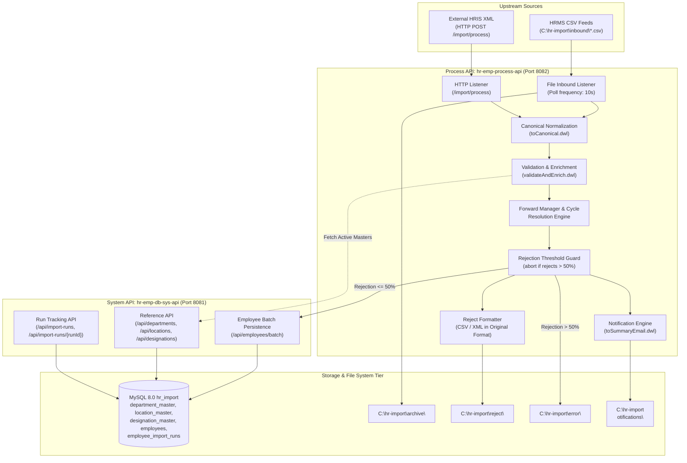
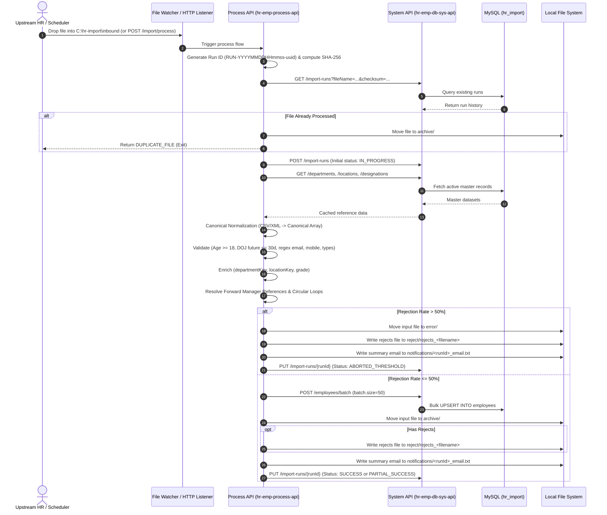

# HR Bulk Employee Import – Project Documentation
**2027 Nurture Partner Network (NPN) MuleSoft Hackathon Challenge (Cognizant)**

---

## 1. Executive Summary & Objective

The **HR Bulk Employee Import** solution is an enterprise-grade, API-led MuleSoft 4 integration designed to ingest high-volume employee demographic records from heterogeneous upstream source systems (CSV and XML), validate and enrich them against relational enterprise masters, resolve complex hierarchical relationships (such as forward manager references and circular reporting), persist clean data into MySQL database tables in micro-batches, and generate downstream audit trails, reject files, and executive email notifications.

---

## 2. API-Led Architecture

The architecture adheres strictly to MuleSoft’s API-Led Connectivity paradigm, decoupling operational business orchestration from underlying database persistence:

---

## 3. Component Breakdown

### 3.1. System API (`hr-emp-db-sys-api`)
* **Base Port**: `8081` | **Base Path**: `/api`
* **RAML Definition**: Clean RESTful interface defining all database operations.
* **Endpoints**:
  * `GET /departments`: Retrieves active departments (`department_key`, `department_code`, `department_name`).
  * `GET /locations`: Retrieves active location entries (`location_key`, `location_code`, `location_name`).
  * `GET /designations`: Retrieves designation-to-grade mappings (`designation`, `grade`).
  * `GET /employees`: Retrieves employee lists, with query filtering for duplicate email checks (`?email=...`).
  * `GET /employees/{employeeId}`: Retrieves a single employee record.
  * `POST /employees/batch`: Executes bulk upsert (`INSERT INTO employees ... ON DUPLICATE KEY UPDATE`).
  * `GET /import-runs`: Checks for duplicate files via filename and SHA-256 checksum query parameters.
  * `POST /import-runs`: Registers new execution run (`RUN-<timestamp>-<hash>`).
  * `PUT /import-runs/{runId}`: Finalizes run statistics, counts, status, and completion timestamp.

### 3.2. Process API (`hr-emp-process-api`)
* **Base Port**: `8082` | **File Watcher**: `C:\hr-import\inbound`
* **Core Responsibilities**:
  * **File Ingestion & SHA-256 Checksum**: Automatically picks up incoming files, computes SHA-256 hash, and verifies against System API to reject duplicate files.
  * **Canonical Normalization**: Maps disparate CSV headers and XML element hierarchies into an internal canonical representation.
  * **Reference Data In-Memory Caching**: Loads active departments, locations, and designations into memory variables during execution to eliminate repetitive database round-trips.
  * **Business Validation Suite**: Performs multi-rule validation on every record.
  * **Forward Manager Reference & Cycle Resolution**: Resolves hierarchical reporting dependencies even when managers appear after subordinates, and detects circular chains.
  * **Rejection Threshold Engine**: Real-time evaluation of rejection rate; if $> 50\%$ (`import.threshold`), skips persistence, moves file to `error/`, marks status `ABORTED_THRESHOLD`, and dispatches failure notification.
  * **Batch Persistence**: Dispatches valid records to System API in configurable chunks (`batch.size=50`).
  * **Reject File Generation**: Preserves original format (CSV with header or XML with `<employeeImportRejects>`) and includes exact `rejectReason`.
  * **Audit Email Summary**: Outputs detailed notifications matching the Cognizant hackathon template to `C:\hr-import\notifications\<runId>_email.txt`.

---

## 4. End-to-End Execution Flow

---

## 5. Canonical Data Model & Field Specification

| Canonical Field | Type | CSV Source Header | XML XPath | Validation / Enrichment Rule |
| :--- | :--- | :--- | :--- | :--- |
| `employeeId` | String | `employeeId` | `employeeId` | Mandatory, Unique per file |
| `firstName` | String | `firstName` | `firstName` | Mandatory, 1-100 characters |
| `lastName` | String | `lastName` | `lastName` | Mandatory, 1-100 characters |
| `dateOfBirth` | Date | `dateOfBirth` | `dateOfBirth` | ISO `yyyy-MM-dd`. Must be $\ge 18$ years old. **Protected sensitive data**. |
| `dateOfJoining` | Date | `dateOfJoining` | `dateOfJoining` | ISO `yyyy-MM-dd`. Cannot be $> 30$ days in the future. |
| `officialEmail` | String | `officialEmail` | `officialEmail` | Mandatory, Regex validated: `^[A-Za-z0-9._%+-]+@[A-Za-z0-9.-]+\.[A-Za-z]{2,}$`. Unique in DB. |
| `mobile` | String | `mobile` | `mobile` | Format: `^\+?[0-9\s\-]{10,20}$`. **Protected sensitive data**. |
| `departmentCode` | String | `departmentCode` | `departmentCode` | Enriched to `department_key` via `department_master`. Must be active. |
| `designation` | String | `designation` | `designation` | Enriched to `grade` via `designation_master`. |
| `locationCode` | String | `locationCode` | `locationCode` | Enriched to `location_key` via `location_master`. Must be active. |
| `employmentType` | String | `employmentType` | `employmentType` | Allowed: `PERMANENT`, `CONTRACT`, `INTERN`, `TRAINEE`. |
| `managerId` | String | `managerId` | `managerId` | Self-reference rejected. Resolves forward references within file or DB. |

---

## 6. Business Validation Rules & Rejection Codes

| Code | Trigger Condition | Severity |
| :--- | :--- | :--- |
| `ERR_VAL_MANDATORY_MISSING` | Any mandatory field (`employeeId`, names, DOB, DOJ, email, codes) is null or blank | Record Rejection |
| `ERR_VAL_UNDERAGE` | Employee age at file processing date is $< 18$ years | Record Rejection |
| `ERR_VAL_DOJ_FUTURE_LIMIT` | `dateOfJoining` is $> 30$ days past the current processing date | Record Rejection |
| `ERR_VAL_INVALID_EMAIL` | `officialEmail` fails standard RFC email regex format | Record Rejection |
| `ERR_VAL_INVALID_MOBILE` | `mobile` fails international format check | Record Rejection |
| `ERR_VAL_INVALID_EMPLOYMENT_TYPE`| `employmentType` is not in (`PERMANENT`, `CONTRACT`, `INTERN`, `TRAINEE`) | Record Rejection |
| `ERR_REF_DEPARTMENT_NOT_FOUND` | `departmentCode` does not match an active record in `department_master` | Record Rejection |
| `ERR_REF_LOCATION_NOT_FOUND` | `locationCode` does not match an active record in `location_master` | Record Rejection |
| `ERR_REF_DESIGNATION_NOT_FOUND`| `designation` does not exist in `designation_master` | Record Rejection |
| `ERR_REF_SELF_MANAGER` | `managerId == employeeId` (employee cannot report to themselves) | Record Rejection |
| `ERR_REF_CIRCULAR_MANAGER` | Circular reporting detected (A reports to B, B reports to A) | Record Rejection |
| `ERR_DB_DUPLICATE_EMAIL` | `officialEmail` already exists in `employees` table under a different ID | Record Rejection |
| `ERR_HEADER_COUNT_MISMATCH` | XML header `<recordCount>` does not equal actual `<employee>` element count | File Rejection |
| `ERR_THRESHOLD_EXCEEDED` | File rejection rate exceeds 50% (`import.threshold=0.50`) | Run Aborted |

---

## 7. Rejection Threshold Guard & Abort Mechanism

1. **Threshold Formulation**:
   $$\text{Rejection Rate} = \frac{\text{Invalid Records}}{\text{Total Parsed Records}}$$
2. **Threshold Check**:
   * Evaluated immediately after validation, enrichment, and relationship resolution, **before any database insertion**.
   * If $\text{Rejection Rate} > 0.50$:
     * Zero (0) records are inserted into `employees`.
     * Run status is set to `ABORTED_THRESHOLD`.
     * Source file is moved directly to `C:\hr-import\error\`.
     * Reject file is generated containing all rejected rows.
     * High-priority alert email is dispatched and written to `C:\hr-import\notifications\`.

---

## 8. Sensitive Data & Privacy Protection

In compliance with data protection policies:
* **Date of Birth (`dateOfBirth`)**: Masked or omitted from all logger statements, console printouts, and notification emails. Only stored in the encrypted/secure database column.
* **Mobile Number (`mobile`)**: Never written to application log files or summary notification email bodies.
* **Reject Files**: Generated in original schema with `rejectReason` column appended, placed in restricted directory `C:\hr-import\reject\`.
